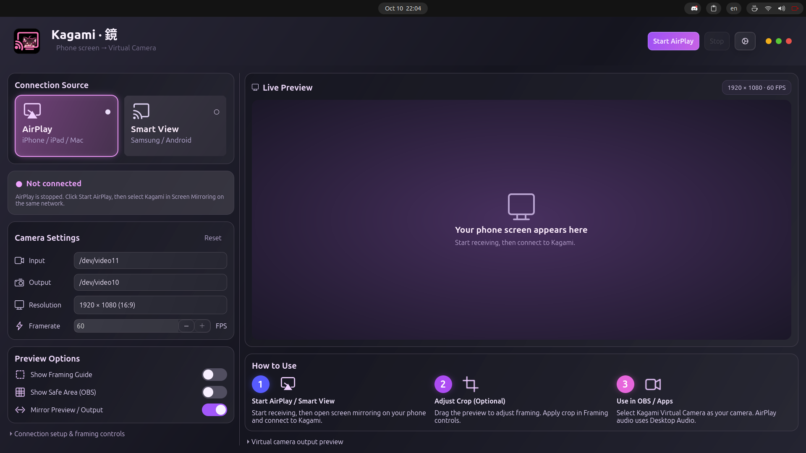
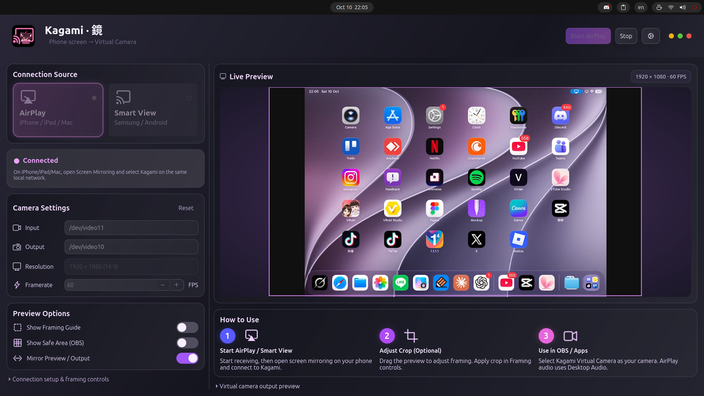

# Kagami · 鏡

**Your phone screen, now a virtual camera.**

Phone / Tablet → Kagami → OBS / Discord

**Linux · Windows in development**

Local-first · No account · MIT

Mirror your phone screen, crop and adjust the picture, then use **Kagami Virtual Camera** in your desktop apps. No separate Kagami phone app or cloud relay required.

รับภาพหน้าจอมือถือ ปรับ Crop แล้วส่งเป็น **Kagami Virtual Camera** ให้แอปบนคอม ไม่ต้องติดตั้งแอป Kagami บนมือถือหรือใช้ Cloud

<strong>Screenshots — click to expand / ภาพหน้าจอ — กดเพื่อเปิด</strong>

Click a preview to view the full-size image. / คลิกภาพตัวอย่างเพื่อดูขนาดเต็ม

| Ready for AirPlay / ก่อนเริ่ม AirPlay | iPad via AirPlay / iPad ผ่าน AirPlay |
| :---: | :---: |
|  |  |

## Platforms / แพลตฟอร์ม

- **Linux:** Ubuntu 24.04/26.04, Debian, Arch, Fedora and compatible derivatives. Ubuntu is the primary desktop; other families have userspace CI coverage and still need full desktop/device testing.
- **AppImage:** x86_64, glibc 2.39+. Host camera drivers and services are required.
- **Windows:** In development / อยู่ระหว่างพัฒนา — download and setup instructions will follow when a build is available.

## Install / ติดตั้ง

For the current **Linux development version**, run as your normal desktop user:

~~~bash
curl -fsSL https://raw.githubusercontent.com/celestial-sora/kagami/main/install.sh | bash
~~~

ติดตั้งเวอร์ชันพัฒนา Linux ด้วยบัญชีผู้ใช้ปกติ ตัวติดตั้งอาจขอรหัส sudo และให้รีบูตเพื่อตั้งค่าไดรเวอร์กล้อง หากทดสอบใน VM ให้ติดตั้งระบบลงดิสก์ก่อน ไม่ใช้ Live ISO

The camera driver needs headers for the running kernel. Custom kernels are supported when matching headers are installed under `/lib/modules/$(uname -r)/build`. On Arch/Manjaro, reboot into the updated kernel and rerun the installer if a full system upgrade replaced the currently running kernel. Smart View requires Wi-Fi P2P client/GO support from the adapter and its Linux driver; AirPlay remains available without P2P.

<strong>Stable release · Ubuntu 24.04 / 26.04</strong>

The latest published stable installer retains its Ubuntu scope. / ตัวติดตั้ง stable ล่าสุดยังใช้กับ Ubuntu

~~~bash
curl -fsSL https://github.com/celestial-sora/kagami/releases/latest/download/install-kagami.sh | bash
~~~

**AppImage:** Download `kagami-appimage-x86_64` from a successful [Checks run](https://github.com/celestial-sora/kagami/actions/workflows/ci.yml). [Setup and requirements →](docs/linux-distributions.md#appimage)

## Connect / เชื่อมต่อ

| Device / อุปกรณ์ | Mode / วิธีเชื่อมต่อ |
| :--- | :--- |
| iPhone / iPad / Mac | **AirPlay** — Screen Mirroring; same LAN / อยู่ใน LAN เดียวกัน |
| Samsung Galaxy | **Smart View** — experimental; adapter and Linux driver must support Wi-Fi P2P client/GO / ขั้นทดลอง อะแดปเตอร์และไดรเวอร์ Linux ต้องรองรับ Wi-Fi P2P |
| Android | **USB / Wi-Fi ADB** — authorized debugging, adb and scrcpy 3.0+ / อนุญาต debugging และติดตั้ง adb กับ scrcpy แยก |

Open Kagami → choose a mode → **Check** → **Start** → connect your phone → apply a crop. In OBS on Linux, add **Video Capture Device (V4L2)** and select **Kagami Virtual Camera**. Click **Stop** when finished.

เปิด Kagami → เลือกโหมด → **Check** → **Start** → เชื่อมต่อมือถือ → ปรับ Crop จากนั้นใน OBS บน Linux เพิ่ม **Video Capture Device (V4L2)** แล้วเลือก **Kagami Virtual Camera** เลิกใช้ให้กด **Stop**

Real iPad video in Kagami and OBS is verified on Ubuntu 26.04. Galaxy end-to-end testing remains pending. AirPlay audio goes to desktop output; use OBS Desktop Audio to capture it.

[Installation & troubleshooting](docs/installation.md) · [Linux requirements](docs/linux-distributions.md) · [Validation status](docs/validation.md)

---

[MIT](LICENSE) · Contributor: **celestail-sora** ([celestial-sora](https://github.com/celestial-sora)) · UxPlay and MiracleCast retain their upstream licenses.
